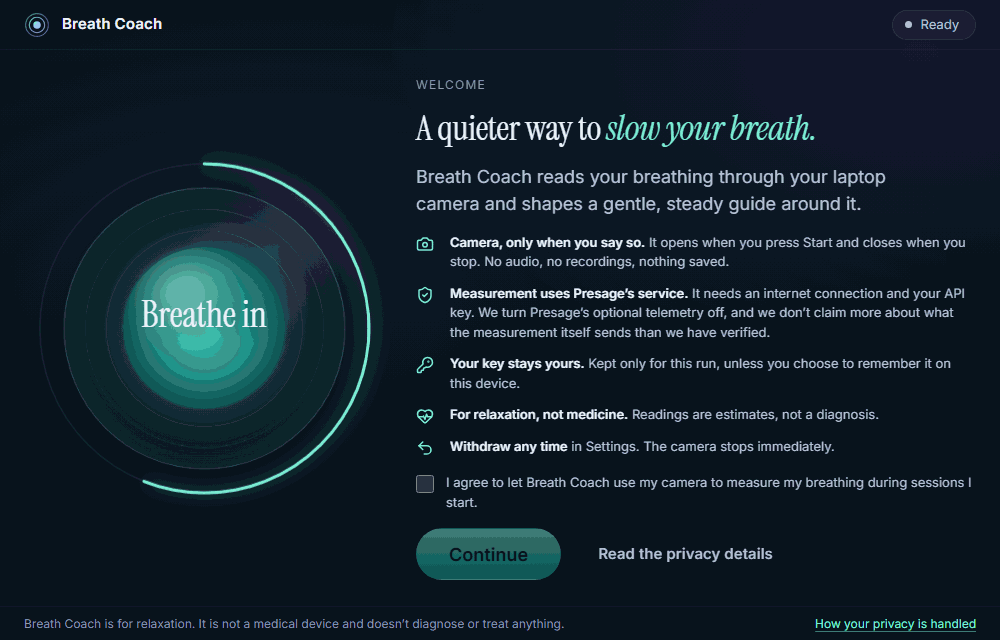
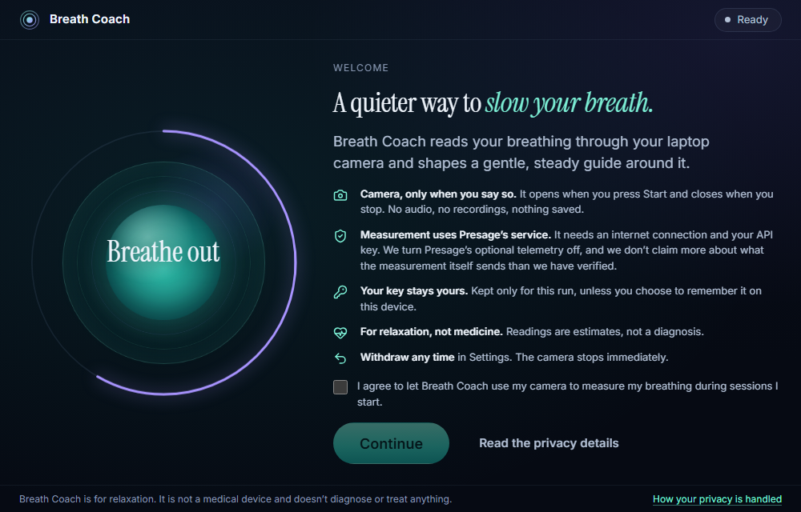
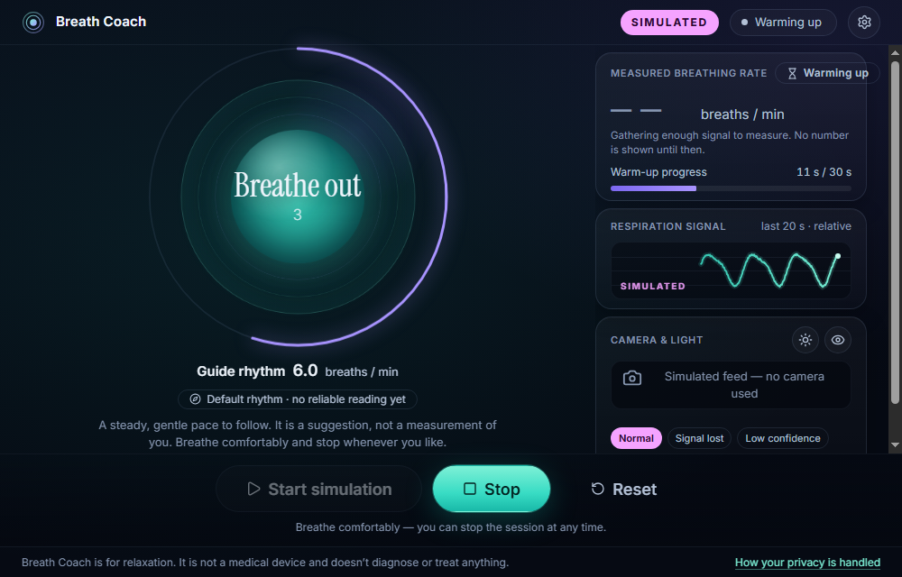
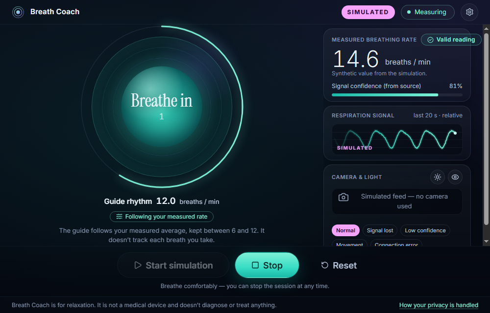
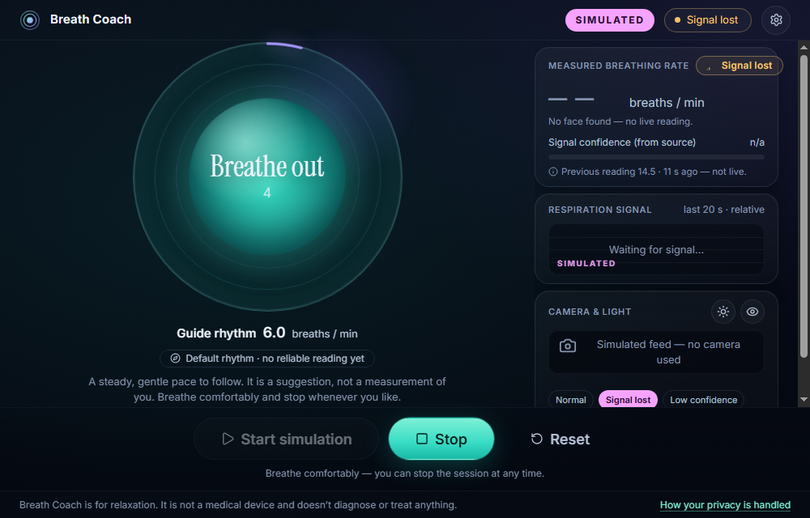
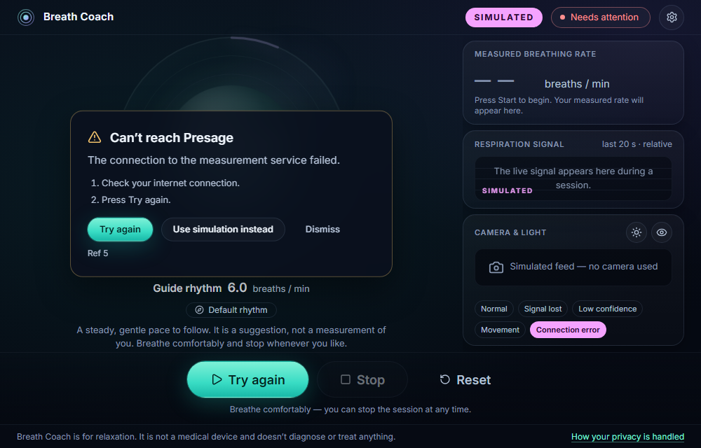
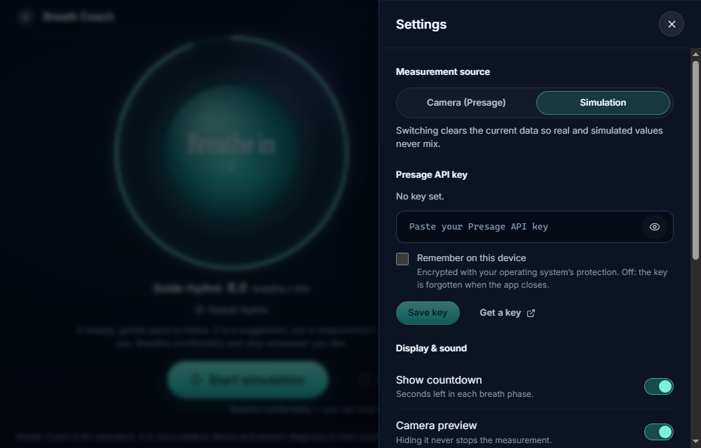

<div align="center">

# Breath Coach

**A quiet desktop breathing coach that measures your breathing through your laptop camera and paces a calm guide around it.**

*Honest by design: a measured number is only ever shown when it is fresh, valid and confident.*


-555)




<sub>**This walkthrough uses the built-in SIMULATED mode** (synthetic data, no camera). The label is on screen the whole time.
Breath Coach is built on <a href="https://smartspectra.presagetech.com/">Presage SmartSpectra</a> for the real measurement.</sub>

</div>

---

## Why Breath Coach

Most breathing apps ask you to follow a circle. Breath Coach also *looks* at your breathing, then keeps four things strictly apart so the
screen never over-claims:

| | What it is | Rule |
|---|---|---|
| **Measured breathing rate** | An average reported by the SmartSpectra SDK | Shown as received. Dashes while warming up, and again whenever the reading is stale, invalid or the signal is lost. |
| **Guide rhythm** | What the circle does (6–12 breaths/min, 40 % in / 60 % out, no hold) | Follows the measured rate **only** if the reading is fresh (≤ 10 s) and confidence ≥ 50 %. Otherwise a steady 6/min, labelled as such. |
| **Signal confidence** | The SDK's own 0–100 value | Never invented. `n/a` when the source gives none. |
| **Warm-up progress** | Elapsed time of the 30 s warm-up | Not a quality score, and finishing it is not proof of a valid reading. |

## Features

- **Calm, precise interface.** A layered breathing orb at the centre, a live respiration trace drawn from the SDK's real signal, tabular
  numerals so nothing shifts while values update, `prefers-reduced-motion` support, full keyboard use and screen-reader labels.
- **Consent first.** The camera opens only after you agree and press Start, and is released on Stop, Reset, withdrawing consent,
  closing the window or any error. The microphone is never requested. Nothing is recorded or saved.
- **Helps you fix the room.** A live **light meter** from the camera preview, hardware **brightness boost** for dim cameras, and a
  **screen light** frame that lights your face.
- **Failure states that explain themselves.** Camera denied, busy or lost; invalid key; no credits; network; a slow camera feed —
  each in plain language with a next step, never a raw SDK message.
- **Explicit simulation.** `SIMULATED` is always visible, never switches on by itself, never uses the camera, never mixes with real data.
- **Hardened Electron app.** Sandbox, context isolation, a request filter that cancels everything but the app's own bundle, a camera
  permission gate that is closed unless a session is armed, Electron fuses on packaged builds. See [SECURITY.md](SECURITY.md).

## Screenshots

| Welcome & consent | Warm-up (no number yet) |
|---|---|
|  |  |
| **Measuring (simulated)** | **Signal lost: the number disappears** |
|  |  |
| **Errors explain the next step** | **Settings** |
|  |  |

<sub>All screenshots show simulated data.</sub>

## Quick start

**Requirements:** Node.js ≥ 20, Windows x64 (the only platform tested), a webcam, and a Presage API key from
[physiology.presagetech.com](https://physiology.presagetech.com/auth/login). Without a key you can explore the simulation.

```bash
npm install
npm run dev        # Vite dev server + Electron
```

Then: tick the consent box → paste your API key → check the **Light** meter says *Good* → sit with face, shoulders and upper chest in
the preview → **Start session** and stay still for 40 seconds. The first reading appears after the 30 s warm-up.

| Command | What it does |
|---|---|
| `npm run dev` | Development (Vite + Electron) |
| `npm run build` / `npm start` | Typecheck, bundle, then run the built app |
| `npm run check` | Typecheck + unit tests + secret scan |
| `npm run test:e2e` | End-to-end run of the real Electron app with a fake camera (no key needed) |
| `npm run pack` / `npm run dist` | Unpacked app / Windows installer (NSIS) in `release/` |
| `npm run demo` | Re-record the README walkthrough (simulated mode) |

> Some shells export `ELECTRON_RUN_AS_NODE=1`, which makes Electron start as plain Node and crash with
> `Cannot read properties of undefined (reading 'setName')`. Run `unset ELECTRON_RUN_AS_NODE`.

## How it works

```
Camera ──► SmartSpectra SDK ──► metrics (rate, confidence, trace) + validation codes
                                        │
                  SessionController (generation-guarded, one session at a time)
                                        │
     assess() decides what may be claimed ──► deriveGuidance() ──► BreathPacer ──► the orb
                                        │
                      store (slow data)  +  ring buffer (trace) ──► canvas
```

- **One source contract.** The real adapter and the simulator both implement `MeasurementSource`; nothing else knows which is active.
- **Stale events can't leak.** Every start, stop, reset or failure bumps a generation; events from an older generation are dropped.
- **Time, not frames.** The pacer runs on a monotonic clock; minimising the window and coming back never desynchronises it.
- **Bounded memory.** The respiration trace is a fixed-size ring buffer, cleared when the session ends.

Details: [docs/ARCHITECTURE.md](docs/ARCHITECTURE.md).

## Project layout

```
electron/                 main process, camera gate, IPC, key storage, sandboxed preload
src/app/                  App.tsx (composition only), session controller, store, hooks
src/features/             consent, setup, measurement, guidance, controls, settings, shell
src/domain/               session machine, measurement validity, breath pacer, light estimate, user-facing copy
src/infrastructure/presage/      the only code that touches @smartspectra/node-sdk
src/infrastructure/simulation/   explicit simulator (same MeasurementSource contract)
src/shared/               types, constants, ring buffer, store, bridge contract
src/styles/               design tokens + component styles
tests/                    behaviour tests
scripts/                  build, e2e, demo, secret scan;  scripts/diagnostics/ real-hardware probes
docs/                     see docs/README.md
```

## Privacy and security

- Camera only after consent and an explicit Start; no recording; no microphone; readings are never saved.
- The API key lives in memory unless you choose "Remember" (encrypted with the OS, Windows DPAPI). Never logged, never in the repo.
- SDK telemetry is turned off. **What the measurement itself transmits to Presage is described by Presage and has not been
  independently verified here**, so Breath Coach does not claim that nothing leaves your device.

Read [docs/PRIVACY.md](docs/PRIVACY.md) and [SECURITY.md](SECURITY.md).

## Troubleshooting

| You see | Meaning | Try |
|---|---|---|
| **The camera feed is too slow (Ref 14)** | The SDK ended the session because too few frames per second reached it | Close heavy apps; use a faster computer. On a 2014 i7-4510U this happened every time, see [docs/REPORT.md](docs/REPORT.md) |
| **Too dark** | The camera image is too dim to measure | Light on your face, the screen-light button, keep *Brighten camera image* on; wait for the meter to say *Good* |
| **Chest not visible / No face found** | Framing | Sit back so face, shoulders and upper chest are in the preview |
| **The API key was not accepted** | Presage rejected the key | Check for typos or extra spaces; make a fresh key |
| Settings → *SDK camera engine (experimental)* | The SDK opens the camera itself | Not verified to be faster; off by default |

## Honest status

| | |
|---|---|
| Verified | Types, 73 unit tests, end-to-end run of the real Electron app, packaged build with fuses, a key accepted by Presage, real sessions reaching the warm-up |
| **Not captured** | **A live breathing reading.** On the development computer every real session ended with SDK error 14 (frame rate too low). A faster computer is needed for a live demo: [docs/TRANSFER.md](docs/TRANSFER.md) |
| Not verified | macOS and Linux; the Windows installer; what the native runtime transmits; screen readers (labels are in place) |

## Contributing

See [CONTRIBUTING.md](CONTRIBUTING.md). The one rule that matters most: **never show a value that is stale, invalid or low-confidence
as live, and never mix simulated and real data.**

## Author

**WAHIB EL KHADIRI**

## Licence

Source code: MIT (see [LICENSE](LICENSE)), Copyright (c) 2026 WAHIB EL KHADIRI.
`@smartspectra/node-sdk` is proprietary to Presage Technologies, Inc. and used under its own licence; its native runtimes ship as
`extraResources` in packaged builds. Breath Coach is for relaxation and is not a medical device.
